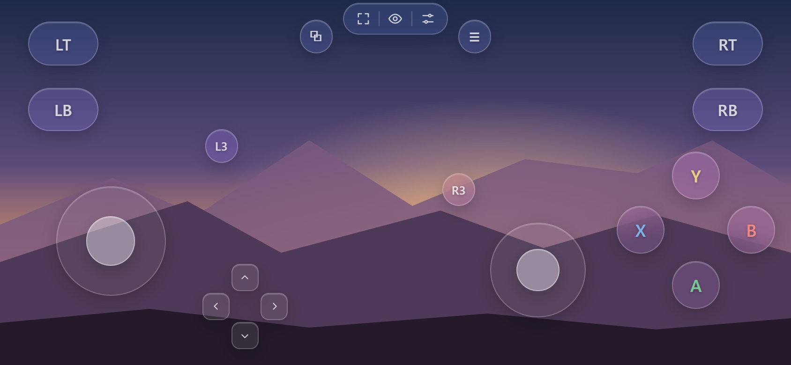
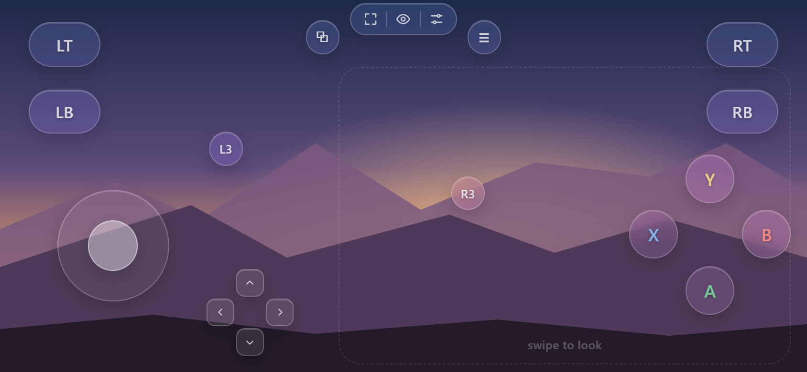
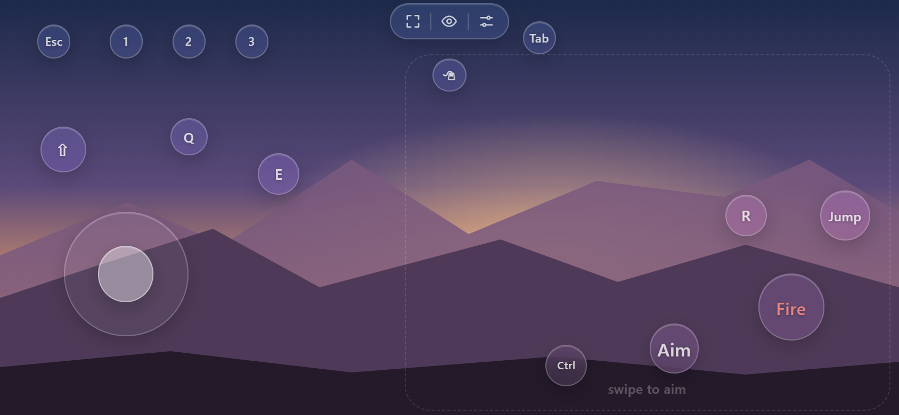
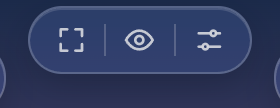
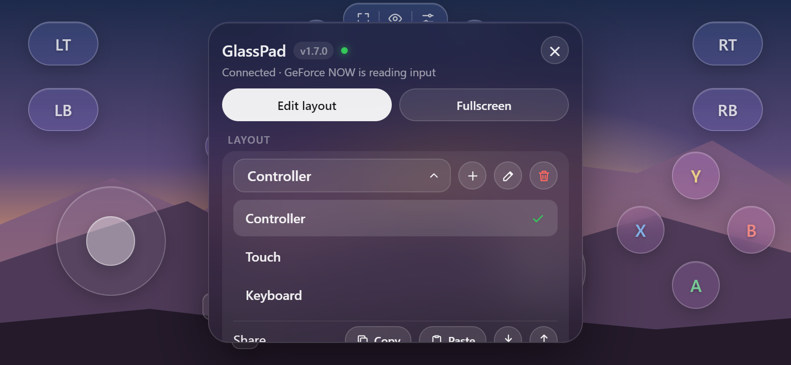
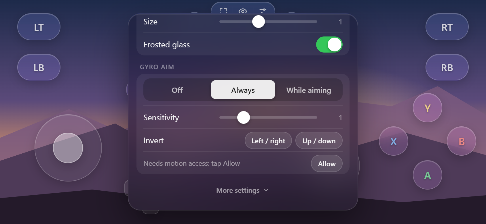
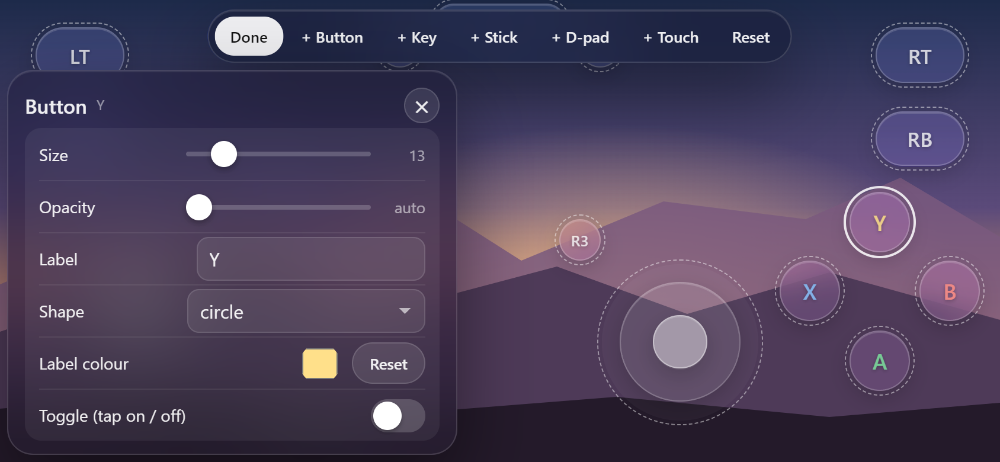

# GlassPad for GeForce NOW (Safari userscript)

Remappable **controller, touch and keyboard** controls for **GeForce NOW** (play.geforcenow.com) in Safari on iPhone
and iPad. GlassPad adds a **virtual Xbox controller** to the page. GFN treats it like a real Bluetooth gamepad, so it
works in any game that supports controllers. You can also swipe on **touch areas** to look around or aim, and send
**keyboard keys** for keyboard games.

Screenshots are from the included test page on an iPhone-sized landscape screen, with a placeholder backdrop
where the game stream would be.

## Built-in layouts
Pick one from the profile list under **Settings → Layout**. You can change every layout, and **Reset** in edit mode
puts it back to the default.

| Layout | What it is |
| --- | --- |
| **Controller** | A full Xbox controller: two sticks, D-pad, ABXY, bumpers, triggers, View/Menu and L3/R3. |
| **Touch** | The same controller, but the right stick is swapped for a big **touch area**. Swipe on the right side of the screen to move the camera. |
| **Keyboard** | WASD stick, keyboard keys and a touch area that aims with the cursor, for keyboard games. **Esc** sits in the top left. |

## Features
- Two analog sticks, a D-pad, ABXY, LB/RB/LT/RT, View/Menu, and L3/R3.
- Drag any control to move it. Change its size, opacity, colour, label and shape. Delete, duplicate or add controls.
- Each button can send **one or more** gamepad buttons, so you can make combos such as LB+RB.
- **Toggle mode** for a button: tap once to hold it, tap again to release. Handy for sprint or crouch.
- Stick modes:
  - **Fixed**: a normal stick.
  - **Floating**: the stick centres wherever your thumb lands.
  - **Swipe-to-look**: works like a touchpad for aiming the camera.
- Per-stick sensitivity, deadzone, touch-area size and invert Y.
- Slide your thumb from one button to another (for example A → B) without lifting it.
- Multi-touch, so you can move, aim and press buttons at the same time.
- **Profiles**, for example one layout per game. Share or back up a layout with one tap: copy/paste it as text, or
  save/open it as a file.
- Hides itself when a real controller connects (you can turn this off).
- Clean frosted-glass look. If the stream stutters on an older device, turn off **Settings → Look → Frosted
  glass**. That keeps the look but skips the blur.
- **Fullscreen** button. See [Fullscreen](#fullscreen).
- Touches on the controls never reach the stream. Touches anywhere else still work as normal GFN touch input.

## Touch areas
A touch area is a rectangle you swipe on. Under *Output* in edit mode it can drive either:
- **Right stick** (used by the **Touch** layout): swipe speed tilts the right stick, and it springs back to centre
  when your finger stops. Use this for camera control in controller games.
- **Cursor** (used by the **Keyboard** layout): swipes move GFN's cursor pixel for pixel, for aiming in keyboard
  games. A quick tap is a left click (you can turn this off). There's also a **Smoothing** setting: higher gives
  silkier but slightly laggier aim, lower is snappier. The default is 0.35.

Each touch area has its own width, height, sensitivity and invert Y. Buttons placed on top of a touch area still
work. Add one with **+ Touch** in edit mode.

## Keyboard
The built-in **Keyboard** layout is set up for shooters:

- **Left stick → W A S D.** Under *Key at the rim* you can add a key that is pressed when you push the stick all
  the way out (for example Shift to sprint).
- **Right side = touch area.** Swipe to aim with the cursor.
- **Buttons:** Esc (top left), 1/2/3, Fire = left click, Aim = right click, plus Jump (Space), R, E, Q, Ctrl, Shift
  and Tab.
- **🖱 button:** toggles GFN's mouse mode by hand. See "How cursor aiming works" below.

Any button can send keys:
- In edit mode, tap a button and type into *Keys*, for example `Shift + W`, `Space`, `F`, `Esc`, `LMB` (left click),
  `RMB` (right click), `WheelUp` or `WheelDown`.
- Or pick keys from the **Add key…** list.
- A single button can send keys and gamepad buttons together.

Other controls:
- **Sticks:** under *Output*, choose **Gamepad stick**, **Keys** (any four keys) or **Cursor**.
- **D-pad:** can send four keys instead, for example `Up, Left, Down, Right` for the arrow keys.

### How cursor aiming works
Safari on iPhone/iPad can't simulate mouse clicks or relative mouse movement for GFN, so the script uses GFN's
built-in **controller-as-mouse mode** instead:
- Double-pressing R3 switches that mode on. The script does this for you the first time you use a control that
  moves the cursor or clicks.
- While the mode is on, the virtual controller's right stick moves the cursor, A is left click and LT is right
  click. The script turns your swipes into exactly those inputs.
- While mouse mode is on, GFN stops passing gamepad buttons to the game. The Keyboard layout isn't affected because
  it sends real keys. Switching to a layout that doesn't use the cursor (Controller or Touch) turns the mode off
  again.
- Switching the mode on or off produces one left click at the cursor. GFN does the same with a real controller.
- The script can't see whether GFN's mouse mode is actually on, so it keeps its own record. If they get out of
  sync, tap the **🖱** button or **Settings → Cursor → Toggle** once (the Cursor section only
  shows up in layouts that use the cursor). Symptoms of being out of sync:
  - swipes don't move the cursor, or move the camera like a stick instead;
  - in a controller layout, buttons do nothing.

## Install (iPhone / iPad)
1. Install **Userscripts** from the App Store (free, by Justin Wasack).
2. Open the **Userscripts** app and tap **Set Userscripts Directory**. Pick a folder, for example
   `iCloud Drive/Userscripts`.
3. Install the script. Either:
   - **From the link (easiest):** open this link in Safari, tap the puzzle/**ᴀA** icon → **Userscripts**, and tap
     the install prompt:
     https://gist.githubusercontent.com/killshotttttt/d4bd9b1bc9ee3115c96c240e08b7fc82/raw/gfn-touch-controls.user.js
   - **By hand:** put `gfn-touch-controls.user.js` into that folder, for example with iCloud for Windows, or by
     emailing it to yourself and choosing **Save to Files**.

   Keep only one copy of the script in the folder. If you're switching to the link install, delete the old file first.
4. Go to **Settings → Apps → Safari → Extensions → Userscripts**. Turn it **on** and set
   **play.geforcenow.com** to **Allow** (or allow All Websites).
5. Open **https://play.geforcenow.com** in a normal Safari tab. Tap the puzzle/**ᴀA** icon → **Userscripts** and
   check that "GlassPad for GeForce NOW" is enabled. Then reload the page.
6. A small glass pill appears at the top centre with three buttons:

   

   - **fullscreen**
   - **eye**: show or hide the controls
   - **settings** (the sliders icon): opens the menu

The **eye** hides the on-screen controls so you can tap GFN's own menus and the game directly, for example to pick
things in a menu. Tap it again to bring the controls back. The virtual controller stays connected while hidden, so
mouse mode and the game's input don't reset. To switch the virtual controller off completely, use
**Settings → More settings → Virtual controller**.

> ⚠️ Safari extensions **do not run in Home Screen web apps**. Launch GFN from a normal Safari tab, not from the
> GeForce NOW icon on your Home Screen. If GFN insists you add it to the Home Screen before it will stream, the menu
> option **More settings → "Act as Home Screen app"** (on by default on iOS) makes the page think it already is.
> Turn it off and reload if it causes layout problems.

## Updates
The script updates itself through the Userscripts app. It's published to a secret (unlisted) GitHub gist, and its
`@updateURL` points there.
- Userscripts checks for new versions every so often. When one is out, it appears under **Updates** in the
  Userscripts popup (puzzle/**ᴀA** icon → **Userscripts**). Tap it to install, then reload GFN.
- To check straight away, open the Userscripts popup, refresh it, and look under **Updates**.
- Your layouts and settings are kept: they're stored in Safari, not in the script file.

Publishing a new version from this PC:
1. Raise `// @version` at the top of `gfn-touch-controls.user.js`, for example 1.7.0 → 1.7.1. The app only updates when
   the version number goes up.
2. Run `bash release.sh`. It checks the file, refuses to publish an old version number, and uploads to the gist.
3. Commit and push to this repo as usual.

## Gyro aim
Aim by moving the phone. Pick a mode under **Settings → Gyro aim** (its other options appear once it's on):
- **Off**
- **Always on**
- **While aiming:** only while you hold Aim / right-click, LT, or any button you give the **Gyro** key in edit mode.

Where the motion goes:
- **Layouts that aim with the cursor (Keyboard):** gyro moves the cursor through the same smooth engine as the
  touch area. This is the real gyro-aim feel, and you can swipe and use gyro at the same time.
- **Controller layouts (Controller, Touch):** gyro tilts the right stick and adds to whatever your thumb or the
  touch area is doing.

Details:
- **Axis layout:** Safari on iPhone labels the rotation axes differently from other browsers. The script works out
  the right layout by itself within a second or two of normal movement, by checking the rotation against how gravity
  shifts. The gyro status in the menu shows which layout it found.
- **Turning:** left/right follows real-world turning, using gravity to know which way is up. It works whether you
  hold the phone upright or tilted back like a handheld console. Tilting the top towards or away from you looks up
  or down.
- **Hand shake** is filtered out, so the aim stays steady when you hold still.
- **Paused** while the controls are hidden (eye button), the menu is open, or you're editing.
- **Settings:** sensitivity (default 10 cursor px per degree) and **Invert** left/right or up/down. If a direction
  feels backwards on your phone, tap the matching Invert button.
- **Permission:** iPhone asks for motion access. Tap **Allow** in the Gyro section. After a reload, iOS asks again on
  your first tap of any control.

## Fullscreen
Tap the fullscreen icon in the top pill, or **Settings → Fullscreen**. Tap it again to exit.
- **iPad:** Safari supports fullscreen for web pages, so the whole page goes fullscreen and the controls stay on top.
  - Safari closes fullscreen whenever you make a quick **one-finger swipe down** anywhere on the screen, for example
    a downward flick on the aim area. Web pages can't block that gesture.
  - So GlassPad puts fullscreen back on your **next tap**, anywhere on the screen. Safari only allows fullscreen to
    start from a tap, so it can't happen sooner.
  - To leave fullscreen for real, tap the fullscreen button in the pill. If Safari has just closed it, tapping the
    button means "stay out".
  - Turn this off under **More settings → Return to fullscreen**.
  - Swipes while another finger is touching the screen (for example a thumb on the stick) don't trigger Safari's
    gesture.
- **iPhone:** Safari doesn't let websites go fullscreen; only videos can, and a fullscreen video would hide the
  controls. The button shows a hint instead. The closest you can get is to turn the phone to landscape and tap
  **ᴀA → Hide Toolbar**. That removes Safari's bars and leaves only a thin address strip. Web pages can't hide
  that strip. Only Home Screen web apps open without it, and Safari extensions such as Userscripts don't run there.

## Customizing

- **Settings → ✎ Edit layout**
  - Drag controls to move them.
  - Tap a control to open its settings: size, opacity, label, colour, shape, toggle mode, which gamepad buttons it
    sends, and stick or touch area options.
  - Use **+ Button / + Key / + Stick / + D-pad / + Touch** to add controls.
  - Use **↺ Reset** to restore the defaults for the current profile.
  - Tap **✓ Done** when you're finished.
- While editing, the settings button can be dragged too.
- **Profiles** (Settings → Layout): pick one from the list. **+** copies the current layout into a new profile,
  **✎** renames it and the bin deletes it.

### Sharing and backups
The **Share** row under **Settings → Layout** works on the current profile:
- **Copy** puts the layout on the clipboard straight away. Paste it into Notes, Messages or a chat to keep or
  share it.
- **Paste** imports a layout you've copied. Safari shows a small **Paste** bubble first; tap it.
- **↓ (save)** saves the layout as a `.json` file. On iPhone/iPad this opens the share sheet, so you can pick
  **Save to Files**, AirDrop or Messages.
- **↑ (open)** imports a `.json` layout file.

An imported layout is always added as a **new profile** and selected, so it never overwrites one you have. If the
name is taken it gets a number, for example "Controller 2". If the clipboard is blocked, a text box appears instead
so you can copy or paste by hand.

Settings are saved per site in `localStorage`.

## Troubleshooting
- **No settings button**
  - Check the extension is allowed on play.geforcenow.com and the script is enabled.
  - Check you're in a Safari tab, not the Home Screen app.
  - Reload the page.
- **Controls show but the game ignores them**
  - Open settings. The line under the title should say `Connected · GeForce NOW is reading input`, with a green dot.
  - If GFN isn't reading the pad, open **More settings** and tap **Reconnect** once the
    game has started.
  - Make sure the game itself supports controllers.
- **Controls vanished**: a real controller was detected. Turn off **More settings → Hide with a real controller**.
- **Stuck input**: lift every finger. Inputs also reset when you leave Safari.
- **Keys do nothing**
  - Tap the game picture once so the stream has focus.
  - Check the game reacts to a real keyboard on GFN.
- **Cursor doesn't move**: tap **🖱** once to resync GFN's mouse mode (see above).

## Testing on a computer
Serve this folder (for example `python -m http.server`) and open `test.html`. The page loads the script and shows
the virtual gamepad's buttons and axes live. Use mouse clicks or touch emulation in DevTools.

The test page also logs key events and copies GFN's controller-as-mouse mode. The yellow dot is the cursor; it turns
red while the left button is held and blue while the right button is held.

## How it works
- The script runs in the page at `document-start`.
- It replaces `navigator.getGamepads()` so the result also includes a virtual pad using the `standard` mapping.
  The pad is a real `Gamepad` instance, gets a fresh snapshot on every state change, and fires `gamepadconnected`.
- One capture-phase listener on `window` is registered before GFN's own listeners. It handles touches on the
  overlay and stops them reaching GFN. All other events pass through untouched.
- The UI lives in a Shadow DOM, so GFN's CSS can't affect it.
- When GFN goes fullscreen (on iPad), the overlay moves into the fullscreen element so it stays visible.
- Keys are sent as synthetic `keydown`/`keyup` events with the right `code` and `keyCode`. GFN's streamer reads them
  from `document`.
- Cursor movement: finger movement on a cursor touch area (or from gyro) is collected in pixels. Each time GFN polls the controller, the script sets the
  right-stick tilt that moves the cursor by that amount, using GFN's own speed formula.
  - **Smoothing window:** the movement is spread over a short window, so cursor speed follows your finger without
    bursts.
  - **Pixel tracking:** the script tracks GFN's whole-pixel stepping, including the leftover fraction GFN discards
    when the stick re-centres, so no movement is lost.
  - **Slow aim:** very slow movement, below GFN's minimum stick tilt, is sent as short, even one-pixel pulses.
  - **Timer correction:** it measures how fast GFN's 8 ms mouse timer really runs and adjusts, so speed stays
    consistent when the phone is busy.
