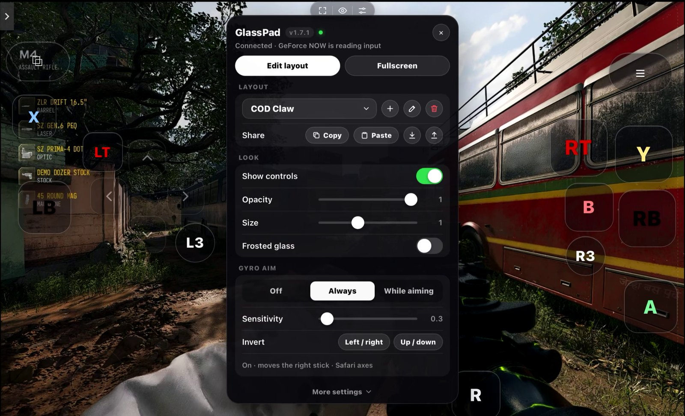
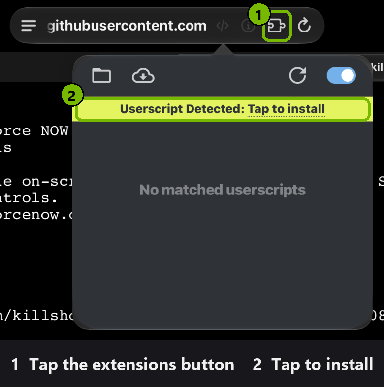
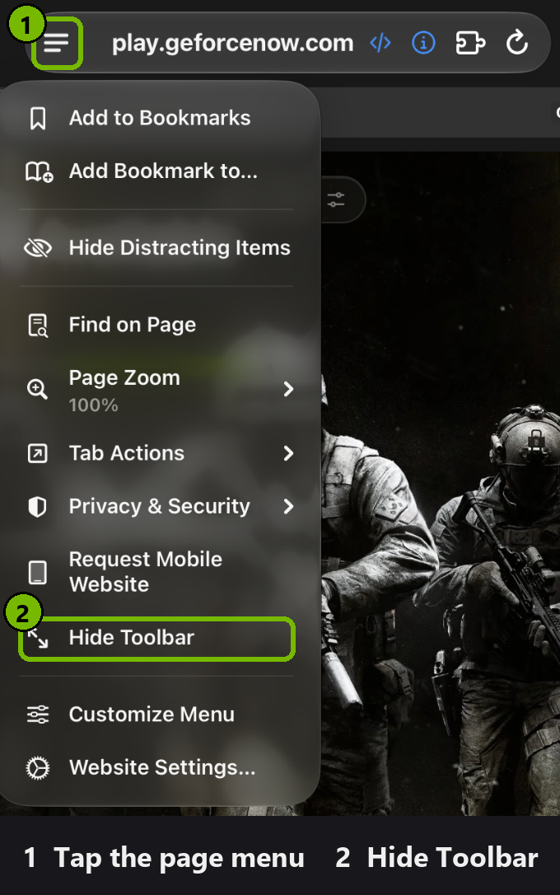

# GlassPad for GeForce NOW

On-screen game controls for **GeForce NOW** in Safari on iPhone and iPad.

GlassPad puts a controller on your screen. GeForce NOW sees it as a real Xbox controller, so it works in any game
that supports controllers. You can also swipe the screen to look around, and add keyboard keys for PC games.
Every button can be moved, resized and remapped.

## Install
You need the free **Userscripts** app. It lets Safari run GlassPad.

1. **Get the app.** Install [Userscripts](https://apps.apple.com/app/userscripts/id1463298887) from the App Store.
2. **Pick a folder.** Open Userscripts, tap **Set Userscripts Directory**, and choose any folder (for example a new
   folder called `Userscripts` in iCloud Drive).
3. **Turn it on in Safari.** Go to **Settings → Apps → Safari → Extensions → Userscripts** (on older iOS:
   **Settings → Safari → Extensions → Userscripts**). Switch it on, and allow it on **play.geforcenow.com**.
4. **Install GlassPad.** Open
   **[this link](https://gist.githubusercontent.com/killshotttttt/d4bd9b1bc9ee3115c96c240e08b7fc82/raw/gfn-touch-controls.user.js)**
   in Safari. You'll see a page of code; that's normal. Tap the **extensions button** in the address bar, then
   **Tap to install**. (On iPhone, the extensions are inside the **ᴀA** menu.)

   

5. **Play.** Open [play.geforcenow.com](https://play.geforcenow.com) in Safari and reload the page. A small bar
   appears at the top of the screen. You're ready.
6. **Optional: get more screen space.** Tap the page menu at the left of the address bar (**≡**, or **ᴀA** on older
   iOS) and choose **Hide Toolbar**.

   

> **Important:** open GeForce NOW in a normal Safari tab. GlassPad doesn't work if you open it from a Home Screen
> icon.

GlassPad updates itself. When there's a new version, open the extensions button → **Userscripts**, tap the update,
and reload.
Your layouts are kept.

## The top bar

- **Fullscreen** (left)
- **Eye** (middle): hides the controls so you can tap GeForce NOW's own menus. Tap again to bring them back.
- **Settings** (right): change layout, edit controls, and more.

## Layouts
GlassPad comes with three layouts. Switch between them in **Settings → Layout**.

- **Controller:** a full Xbox controller with two sticks.
- **Touch:** the same controller, but instead of a right stick you swipe on the right side of the screen to look
  around.
- **Keyboard:** for PC games that need a keyboard. Move with W A S D, swipe on the right side to aim, and tap
  buttons for keys like Space, R, E, 1, 2, 3. **Esc** is in the top-left corner.

## Make it your own
Open **Settings → Edit layout**.

- **Move** a control by dragging it.
- **Tap** a control to change its size, label, colour, and what it does. A button can press any controller button,
  any keyboard key, or both.
- **Add** controls with the buttons at the top: **+ Button**, **+ Key**, **+ Stick**, **+ D-pad**, **+ Touch** (an
  area you swipe on).
- **Hide** a control by setting its **Opacity** to 0. It still works, you just can't see it. Touch areas are hidden
  like this from the start, and they show up faintly while you edit. **Auto** makes a control follow the main
  opacity in Settings.
- **Reset** puts the layout back the way it was.
- Tap **Done** when you're finished.

You can make as many layouts as you like (for example one per game) with the **+** next to the layout name.

**Sharing:** under **Settings → Layout → Share**, tap **Copy** and send the text to a friend. They tap **Paste** to
add it. You can also save a layout as a file and open it later.

## Gyro aim
Aim by moving your phone. Turn it on in **Settings → Gyro aim**:
- **Always:** gyro is always on.
- **While aiming:** gyro only works while you hold the Aim or LT button.

Your iPhone will ask for permission to use motion. Tap **Allow**. If a direction feels backwards, use the
**Invert** buttons.

## Fullscreen
- **iPad:** tap the fullscreen button in the top bar. If Safari exits fullscreen (a quick swipe down can do this),
  just tap the screen and GlassPad goes back to fullscreen.
- **iPhone:** Safari doesn't allow fullscreen on iPhone. To get the most screen space, turn your phone sideways and
  use **Hide Toolbar** from the page menu (install step 6).

## Problems?
- **I don't see the top bar.** Check that Userscripts is switched on for play.geforcenow.com, that you're in a
  Safari tab (not a Home Screen icon), and reload the page.
- **The game ignores the controls.** Open Settings. Under the title it should say *GeForce NOW is reading input*
  with a green dot. If not, start the game, then tap **More settings → Reconnect**. Also check that the game
  supports controllers.
- **The controls disappeared.** GlassPad hides itself when you connect a real controller. To stop that, turn off
  **More settings → Hide with a real controller**.
- **Keys do nothing.** Tap the game once, then try again.
- **Swiping doesn't aim** (Keyboard layout), or **buttons stop working** (Controller layout). Tap the **🖱** button,
  or **Settings → Cursor → Toggle**, once.
- **A button feels stuck.** Lift all your fingers off the screen.
- **The game stutters on an older device.** Turn off **Settings → Frosted glass**.

<b>For developers</b>

### Testing on a computer
Run `python -m http.server` in this folder and open `test.html`. It loads the script and shows the controller's
buttons, sticks and key presses live. Turn on touch emulation in your browser's dev tools to try the controls.

### Publishing a new version
1. Raise `// @version` at the top of `gfn-touch-controls.user.js`. The app only updates when the number goes up.
2. Run `bash release.sh`. It uploads the script to the gist that the install link and auto-update use.
3. Commit and push.

### How it works
- GlassPad replaces `navigator.getGamepads()` so it also returns a virtual Xbox controller.
- Keys are sent as `keydown`/`keyup` events, which GeForce NOW reads like a real keyboard.
- Safari won't let a page move GeForce NOW's mouse, so cursor aiming uses GeForce NOW's own "controller as mouse"
  mode (double-press R3). Swipes are turned into right-stick movement that moves the cursor by the right number of
  pixels.
- Touches on the controls are kept away from the game. Touches anywhere else work as normal.
- Settings are saved in Safari's `localStorage`.

